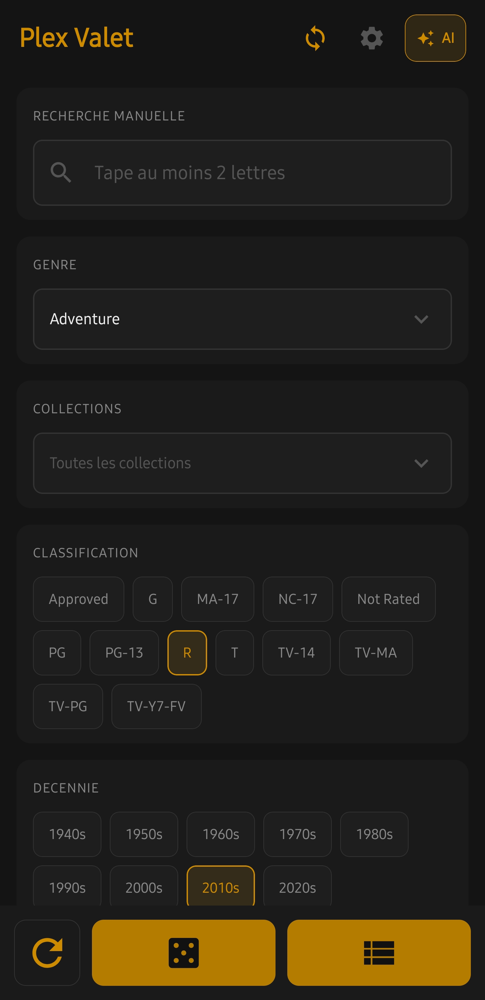
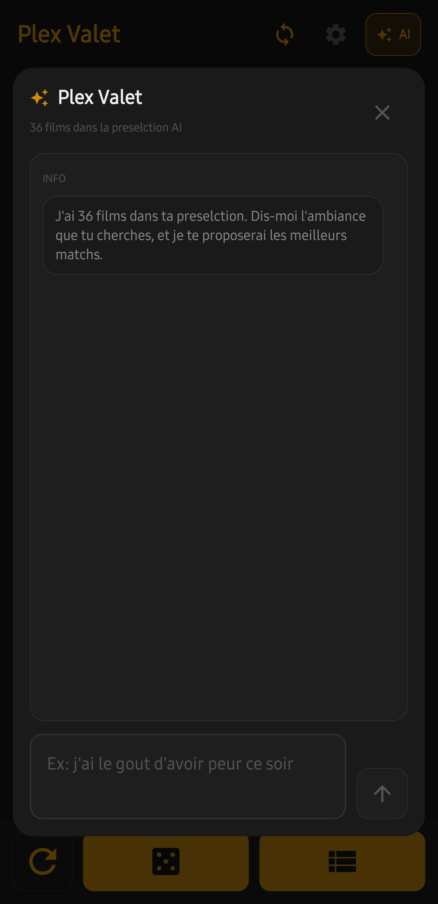
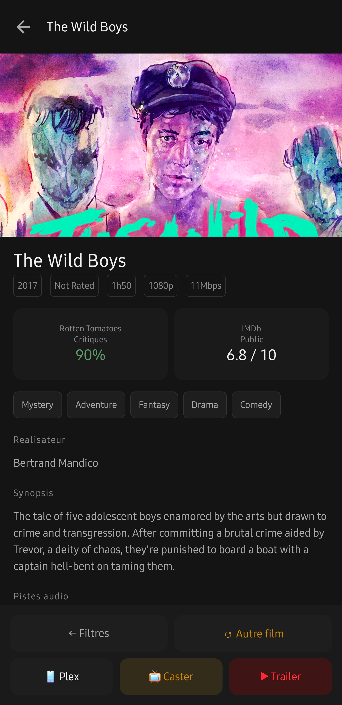

# Plex Valet

I found the official Plex app too limited and slow, so I created Plex Valet as a free, open-source alternative.

An Android companion that helps you choose what to watch from your own Plex movie library. Filter your collection, pick a random movie, browse a shortlist, or ask the optional Claude advisor for suggestions.

## Features

- Search by title and filter by genre, collection, age rating, decade, Rotten Tomatoes score, audio language, runtime, resolution, and watched status.
- Pick a random movie, reroll, or browse all matching movies in a playlist view.
- View movie details, Rotten Tomatoes critics scores, IMDb audience scores, audio/subtitle languages, HDR, and bitrate, when Plex provides them.
- Open Plex, control a compatible Plex player on your network, or search YouTube for a trailer.
- Refresh with live progress. After the first scan, unchanged movie details are reused; a full refresh remains available in Settings.
- Get optional Claude recommendations based on your filtered movies and the mood you describe.

## Screenshots

<table>
  <tr>
    <td width="33%"></td>
    <td width="33%"></td>
    <td width="33%"></td>
  </tr>
  <tr>
    <td><strong>Find your shortlist.</strong><br>Combine filters to narrow down your Plex collection.</td>
    <td><strong>Describe your mood.</strong><br>Ask the optional AI advisor for suggestions from your selection.</td>
    <td><strong>Choose and watch.</strong><br>Check scores and media details, then open Plex or choose a player.</td>
  </tr>
</table>

## Get started

1. Build and install the app on Android 8.0 or newer.
2. In **Paramètres**, enter your Plex server's IP address and Plex token, then tap **Tester et sauvegarder**. Your phone must be able to reach the server on port `32400`.
3. Tap the refresh icon to scan your movie libraries, then start filtering. For a forced scan, use **Paramètres → Bibliothèque locale → Forcer un refresh complet**.

Plex playback requires a compatible Plex app/player. Ratings depend on the sources available in your Plex metadata; missing scores display `N/A`.

## Build

Open the project in Android Studio with JDK 17 or 21 and Android SDK 34. Android Studio creates `local.properties` for the SDK path. For the optional AI advisor, add `ANTHROPIC_API_KEY` locally using [local.properties.example](local.properties.example), then rebuild.

```sh
sh ./gradlew assembleDebug testDebugUnitTest lintDebug
```

On Windows, use `.\gradlew.bat` instead of `sh ./gradlew`. The debug APK is generated at `app/build/outputs/apk/debug/app-debug.apk`.

Local configuration, credentials, APKs, build output, and device data are excluded by `.gitignore`. Personal builds embed the optional Anthropic key, so do not distribute an APK containing your key. Using the advisor sends your messages and filtered movie metadata to Anthropic.

See [development notes](docs/DEVELOPMENT.md) for architecture, sync behavior, and privacy details, and [CHANGELOG.md](CHANGELOG.md) for the change history.

## License

Plex Valet is free and open source under the [MIT License](LICENSE).

The source code and application are in French.

Conçu par Sébastien Bédard
